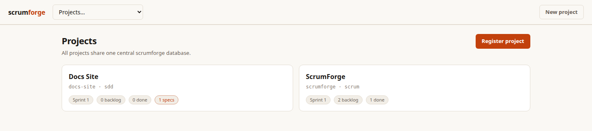
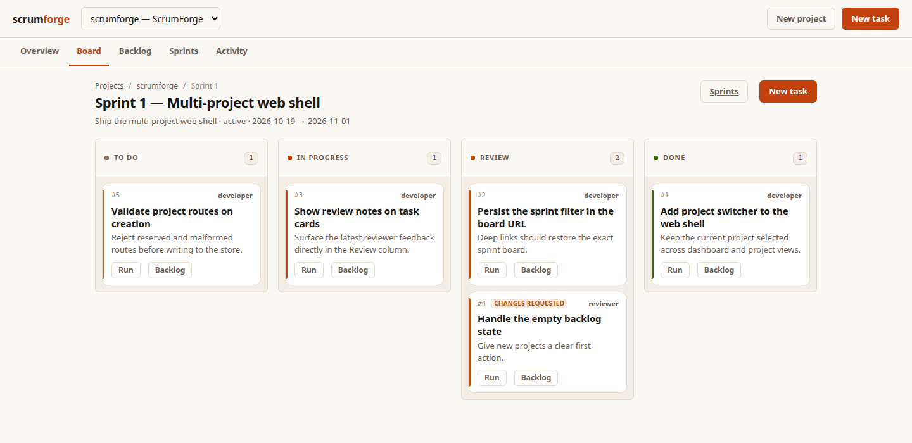
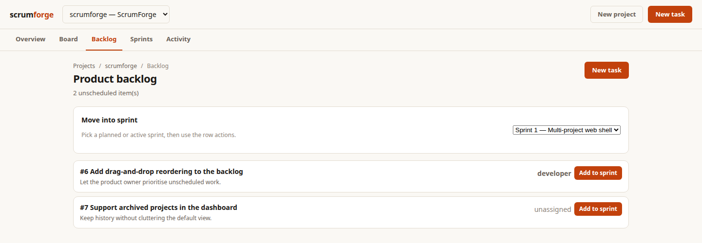
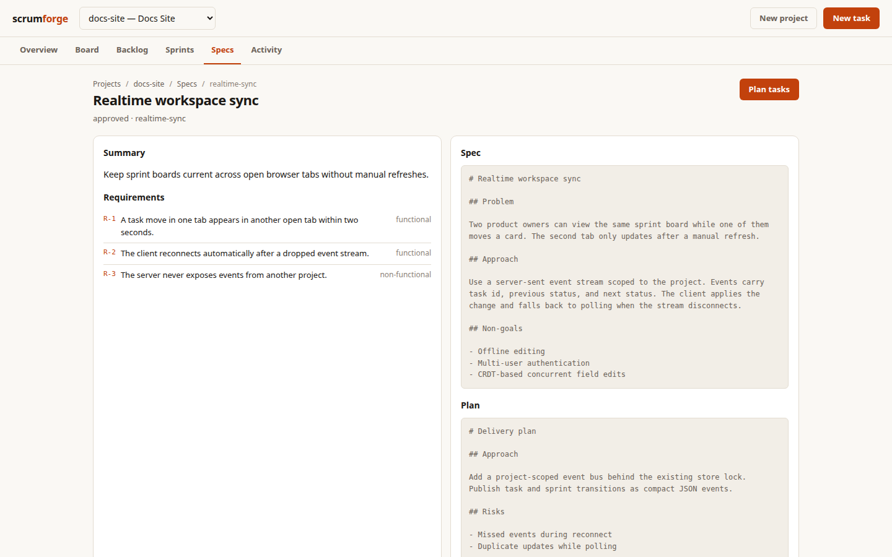

# scrumforge

An AI scrum team orchestrator for multiple repositories. You act as **product
owner**; AI agents — driven via [`opencode`](https://opencode.ai) — play **scrum
master**, **spec planner**, **developer**, and **code reviewer**.

One global SQLite store holds every registered project, sprint, task, spec, and
activity event. Each project gets its own URL-safe route, a sprint-scoped board,
an isolated worktree root, and a choice of methodology:

- **Scrum** — backlog → sprint planning → sprint board → review → close.
- **SDD** — spec → plan → tasks → implement → verify → archive.

Tasks are always scheduled into a sprint for work. Unscheduled tasks live in the
separate product backlog.

```text
backlog ──plan──> todo ──> in-progress ──> in-review ──> done
                     ^                         │
                     └──── changes-requested <─┘
```

## Screenshots









## Requirements

- Rust (to build), [opencode](https://opencode.ai) CLI (runs the agents)
- `git`, and `gh` authenticated (`gh auth login`) for the PR flow
- A GitHub project repo you can push branches to

## Install

```bash
./install.sh
```

Builds the release binary, symlinks it into `~/.local/bin`, and adds a
`scrumforge` alias to `~/.bashrc` and `~/.zshrc`.

## Quick start

```bash
# Register a repository once, with a required route
scrumforge project add acme ~/code/acme --name "Acme" --methodology scrum

# Plan and activate a sprint
scrumforge --project acme sprint add --name "Sprint 1" --goal "Ship login"
scrumforge --project acme sprint activate 1

# Product-owner work
scrumforge --project acme request "add password reset by email"
scrumforge --project acme tasks
scrumforge --project acme run 1
scrumforge --project acme run 1        # reviewer pass on the in-review task
scrumforge --project acme rework 1     # only if changes were requested
```

Run the server once for all projects:

```bash
scrumforge serve            # http://127.0.0.1:3030
scrumforge --web            # same
```

The web UI opens on a global project dashboard. Project views live under
`/p/<route>/...`:

```text
/                              global project dashboard
/p/<route>                     project overview
/p/<route>/backlog             product backlog
/p/<route>/sprints             sprint list
/p/<route>/sprints/<number>    sprint board
/p/<route>/specs               SDD specs
/p/<route>/specs/<slug>        spec detail
/p/<route>/activity            project event feed
```

## Command overview

All project-scoped commands accept `--project <route>`. Without it, scrumforge
uses `SCRUMFORGE_PROJECT`, the nearest `.scrumforge.toml`, or the registered
project containing the current directory.

```bash
scrumforge project add|list|show|set|archive|rm|rename-route|migrate
scrumforge sprint add|list|show|activate|close|board
scrumforge backlog add|list
scrumforge tasks [--sprint current|backlog|all|<number>]
scrumforge show <id>
scrumforge assign <id> <profile|role>
scrumforge move <id> <status|sprint:<n>>
scrumforge run <id>
scrumforge rework <id>
scrumforge review <id> "<feedback>"
scrumforge request "<text>"
scrumforge spec new|list|show|approve|plan|export|archive
scrumforge change new|list|approve
scrumforge context [--json]
scrumforge activity [--limit N]
scrumforge worktree list|prune
scrumforge db backup|check
scrumforge help [topic]
```

`request` asks the scrum master (Scrum) or spec planner (SDD) to split your text
into work. In SDD projects the result is a draft spec: approve it with
`spec approve <slug>`, then create tasks with `spec plan <slug>`.

### Global options

```text
--project <route>   target a project explicitly
--profile <id>      actor identity (default: product-owner)
--db <path>         override the central database
--json              machine-readable output
--all               aggregate across projects where supported
```

### TUI keys

Launch with no command (or `scrumforge tui`) from inside a registered project.

| Key | Action |
| --- | --- |
| `hjkl` / arrows | navigate columns and tasks |
| `Enter` | open task modal (`r` run, `w` rework, `v` review) |
| `r` | send selected task to its assignee |
| `w` | developer reworks after changes requested |
| `v` | review: send task back in progress with feedback |
| `R` | ask the planner for a request |
| `a` | add a backlog task |
| `b` | toggle board / backlog view |
| `s` | cycle active sprint |
| `:` | command mode (`run 3`, `assign 3 reviewer`, `review 3 ...`) |
| `?` / `F1` | help overlay |
| `q` | quit (`Esc` closes modals/help) |

## How it works

- One global SQLite database stores all projects. Resolution order is `--db`,
  `SCRUMFORGE_DB`, `database.path` in `~/.config/scrumforge/config.toml`, then
  `$XDG_DATA_HOME/scrumforge/scrumforge.db` (or
  `~/.local/share/scrumforge/scrumforge.db`).
- The database uses WAL, foreign keys, and a busy timeout so the CLI, TUI, REPL,
  and web server can share it.
- Projects are identified by a required route (lowercase letters, digits, and
  hyphens; 2–48 chars). Reserved routes such as `api`, `p`, and `admin` are
  rejected.
- Agents are non-interactive `opencode run` invocations that must reply with a
  single JSON object. See [GUIDE.md](GUIDE.md) for role playbooks and reply
  contracts.
- The developer works in `<worktree_root>/<route>/<branch>`, defaulting to
  `~/dev/worktrees/<route>/<branch>` — never inside the repo tree. Branches are
  `scrumforge/task-<id>`; task ids are globally unique.
- The reviewer reads the PR diff; on approve it squash-merges and removes the
  worktree, on changes it records notes and moves the task to
  `changes-requested`.
- SDD specs keep requirements and a plan. `spec plan` generates one backlog task
  per requirement with `spec_slug` and `requirement_key` links.

## Development

```bash
cargo build            # compile
cargo clippy           # lint (kept warning-free)
cargo run              # TUI
cargo run -- repl      # REPL
cargo run -- serve     # web UI and API
cargo run -- tasks     # CLI
```

- [AGENTS.md](AGENTS.md) — guidance for coding agents working on this repo
- [AGENTS-CLI.md](AGENTS-CLI.md) — CLI guide for coding agents *using* scrumforge
- [GUIDE.md](GUIDE.md) — role playbooks for the agents scrumforge hires
- [docs/design-web-and-multi-project.md](docs/design-web-and-multi-project.md) —
  design spec for the multi-project store and web UI
- [install.sh](install.sh) — build + alias installer

## Caveats

- The reviewer merges automatically on approve — no human confirmation gate yet.
- Agent runs can take minutes; in the TUI a busy overlay shows while they work
  (Ctrl-C aborts, store state is saved per step).
- The web UI is loopback-only and has no authentication.
- `serve` does not require a current project; it opens the global dashboard.
